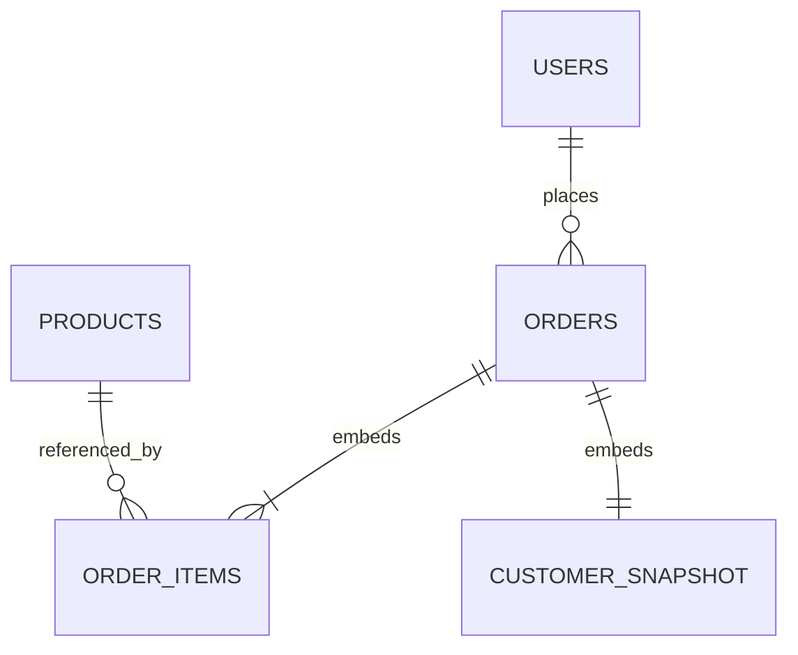

# Part 1 — Initial schema design

## Model selection

| Model | Fit for this application |
| --- | --- |
| Document | **Chosen: MongoDB.** Flexible product attributes and bounded embedded order snapshots fit the operational queries. Single-document updates are atomic. |
| Key-value | Useful for a product cache or cart; secondary search and sales analysis would require separate structures. |
| Wide-column | Suitable for high-volume time-series sales facts; requires more query-specific duplication for catalog search and orders. |
| Graph | Useful for recommendations and relationships, but those traversals are not part of the required workload. |

The initial deployment uses a three-data-bearing-member replica set, one primary and two secondaries. The logical schema is unsharded. The local executable demo uses one temporary member for convenience.

## Entities and relationships



`ORDER_ITEMS` and `CUSTOMER_SNAPSHOT` are embedded objects, not collections. `customerId` and `items.productId` reference other collections without database-enforced foreign keys. Checkout validates references before storing an order; historical orders remain readable when catalog or profile data changes. No list of orders is embedded in a user, avoiding unbounded documents and hot user updates.

## Example documents

JavaScript notation below represents BSON dates with `ISODate`. [Fixtures](../src/fixtures.mjs) and [validators](../src/schema.mjs) are executable using the Node driver.

```javascript
// users
{
  _id: "customer-001",
  name: "Alex Kouame",
  email: "alex@example.test",
  address: { line1: "12 Market Street", city: "Abidjan", country: "CI" }
}

// products
{
  _id: "product-001", sku: "HEADPHONES-01",
  name: "Wireless Headphones",
  description: "Comfortable wireless audio for music and calls",
  category: "electronics", priceMinor: 5000, currency: "USD", active: true
}

// orders (requestHash is populated by prepareOrder)
{
  _id: "order-001", schemaVersion: 1, customerId: "customer-001",
  customer: {
    name: "Alex Kouame", email: "alex@example.test",
    address: { line1: "12 Market Street", city: "Abidjan", country: "CI" }
  },
  items: [
    { lineId: "1", productId: "product-001", sku: "HEADPHONES-01",
      name: "Wireless Headphones", quantity: 2, unitPriceMinor: 5000 },
    { lineId: "2", productId: "product-002", sku: "MUG-01",
      name: "Ceramic Mug", quantity: 1, unitPriceMinor: 1500 }
  ],
  currency: "USD", totalMinor: 11500, paymentStatus: "paid",
  deliveryStatus: "placed", version: 0,
  createdAt: ISODate("2026-10-01T10:00:00Z"),
  updatedAt: ISODate("2026-10-01T10:00:00Z"),
  requestHash: "<SHA-256 of the original checkout draft>"
}
```

Amounts are integer minor units: USD/EUR use cents and XOF uses francs. Currency is explicit; totals from different currencies must never be added together. Taxes, shipping fees, discounts, inventory reservation, and payment-provider integration are outside this exercise. Here, `totalMinor` is the item subtotal and all order items use the order currency. The caller supplies trusted, server-validated prices and an already authorized payment. This is a persistence exercise, not a public checkout API.

Validators require types, status values, and snapshots and reject unexpected fields. Each order is limited to 100 lines, quantities to 1–1000, and the subtotal to 2,000,000,000 minor units. The application additionally checks subtotal arithmetic and duplicate line IDs. These bounds keep embedded documents well below MongoDB's 16 MiB limit for normal product names/addresses; a production API must also enforce string and request-size limits. Each order ID is a caller-generated UUID in production; stable readable IDs make the sample easier to inspect.

## Query patterns and indexes

| Query | Index | Reason |
| --- | --- | --- |
| Product detail | Unique `_id` or unique `{sku: 1}` | Direct lookup |
| Active products by category, sorted by price | `{active: 1, category: 1, priceMinor: 1, _id: 1}` | Equality prefix followed by stable price ordering |
| Full-text catalog search | `{name: "text", description: "text"}`, name weight 5 | Token-based relevance search |
| Customer order history, newest first | `{customerId: 1, createdAt: -1, _id: -1}` | No join to retrieve order snapshots |
| Current order status | Unique `_id` | Fetch one bounded document |
| Customer email lookup | Unique `{email: 1}` | Prevent duplicate normalized emails |

Normalize email addresses in the application before writes. The exercise uses exact binary email/SKU uniqueness. Text search uses MongoDB's built-in English tokenization, with one text index per collection. It supports full-text matching and relevance, but autocomplete, typo tolerance, and more sophisticated multilingual search need a dedicated search tier. Text indexing increases write and memory costs. See MongoDB's [text index documentation](https://www.mongodb.com/docs/manual/core/indexes/index-types/index-text/).

```javascript
db.products.find({ active: true, category: "electronics", priceMinor: { $lte: 10000 } })
  .sort({ priceMinor: 1, _id: 1 }).limit(20);

db.products.find(
  { active: true, $text: { $search: "wireless" } },
  { name: 1, priceMinor: 1, score: { $meta: "textScore" } }
).sort({ score: { $meta: "textScore" } }).limit(20);

db.orders.find({ customerId: "customer-001" })
  .sort({ createdAt: -1, _id: -1 }).limit(20);
```

Use keyset pagination with `(priceMinor, _id)` or `(createdAt, _id)` continuation values for subsequent pages; large `skip` offsets increase work.

## Write throughput and consistency

Order creation writes one document without joining or updating the customer record. Keep only necessary indexes on this write-heavy collection. Connection pooling, concurrent asynchronous operations, bounded documents, and appropriately sized storage provide the starting point for thousands of business transactions per second. This is a capacity goal, **not a measured throughput guarantee**. If one primary reaches its limit, Part 2 distributes orders across shards.

`placePaidOrder` uses majority journaled acknowledgment with a ten-second write concern timeout. A stable order ID and payload hash make retries idempotent; reuse of an ID with different input fails. A timeout is an uncertain outcome, so retry the same ID and payload. Never generate a new order ID simply because acknowledgment timed out.

Delivery follows `placed → processing → shipped → delivered`; cancellation is allowed before shipment. `advanceDelivery` compares the expected version and current status in the update filter, then increments the version atomically. Two writers cannot both overwrite version 0. Delivery cancellation does not itself refund a payment; payment reversal is a separate ledger event in Part 2.

For read-after-write status confirmation, use one causal session with majority writes and majority reads against the primary, passing the session to both calls. Majority alone does not promise globally latest values across unrelated sessions. A primary linearizable single-document read can provide stronger real-time ordering where needed. These guarantees and the costs of cross-document transactions are documented under [read isolation and consistency](https://www.mongodb.com/docs/manual/core/read-isolation-consistency-recency/) and [causal sessions](https://www.mongodb.com/docs/manual/core/causal-consistency-read-write-concerns/).

Catalog browsing can use `secondaryPreferred` with local reads or a short-lived cache when stale descriptions/prices are acceptable. Checkout always revalidates price and availability against the authoritative write path. Customer/order data stays off the public catalog cache.
