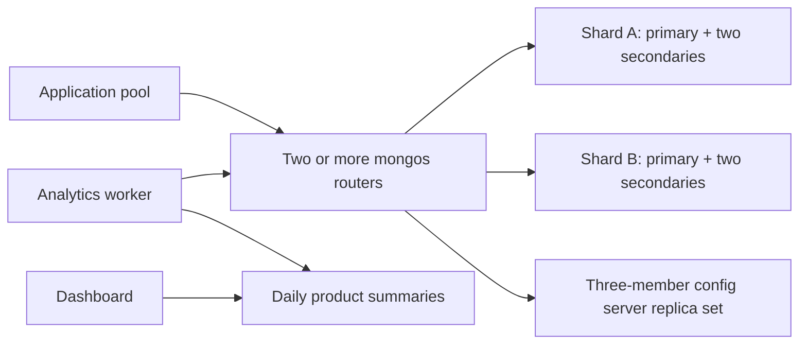

# Part 2 — Refactored schema

## Strategy and topology

Use **sharding + replication + denormalized materialized summaries**. Preserve the order snapshot shape and introduce append-only sales facts and daily product summaries. Checkout and delivery remain authoritative operational operations; dashboards accept delayed refreshes.



Each shard and the config server replica set has three voting, data-bearing members, spread one per availability zone. Run routers in multiple zones and supply multiple router addresses to clients. A single node or zone failure can retain a voting majority in each set and allow election/failover; a brief interruption is still possible. Replication does not multiply primary write capacity. Add shards to distribute writes. Maintain backups and restore drills because replication also replicates mistakes.

## Collections and shard keys

| Collection | Change | Distribution | Trade-off |
| --- | --- | --- | --- |
| `users` | Same profile schema | Unsharded, replicated on its hosting shard | Keeps global unique email; profile writes remain bounded by one primary |
| `products` | Same searchable catalog | Unsharded, replicated on its hosting shard | Preserves unique SKU and simple text search; catalog writes remain bounded by one primary |
| `orders` | `schemaVersion: 2`; same snapshot and version fields | `{_id: "hashed"}` | Spreads IDs/writes; customer history queries scatter across shards |
| `sales_facts` | One immutable signed fact per sale line or adjustment | `{_id: "hashed"}` | Distributed ingestion and retry routing; date scans fan out |
| `daily_product_sales` | Persisted daily product totals | `{_id: "hashed"}` | Spreads buckets; cross-product/date rankings fan out over fewer documents |

MongoDB [hashed sharding](https://www.mongodb.com/docs/manual/core/hashed-sharding/) trades more even distribution for weaker targeting of range queries. An order lookup/update includes `_id` and targets its shard. Choosing customer ID instead would improve history locality but concentrate a large customer's writes. Avoid timestamp-only shard keys, which focus current writes on a range's newest chunk. Verify actual distribution and active chunk placement with production-like data; adding shards does not instantly rebalance a populated collection.

Retain the Part 1 lookup indexes. Add `{occurredAt: 1}` on facts and `{currency: 1, day: 1, productId: 1}` on summaries. All three sharded collections also get `{_id: "hashed"}`. The hashed index is **not unique**; the regular unique `_id` index remains, and identical `_id` values route to the same shard. No unique customer-history or event-date indexes are added. Keeping `users` and `products` unsharded avoids incompatible global email/SKU constraints. See MongoDB's [shard key index restrictions](https://www.mongodb.com/docs/manual/core/sharding-shard-key-indexes/).

At larger catalog scale, introduce an independently scaled search index and replicated cache; catalog changes would propagate asynchronously. That additional service is a future extension, not part of this implementation.

## New schema examples

```javascript
// sales_facts: initial purchase of two headphones
{
  _id: "<SHA-256 of [orderId, lineId, 'sale']>",
  orderId: "order-001", productId: "product-001", currency: "USD",
  occurredAt: ISODate("2026-10-01T10:00:00Z"),
  quantity: 2, revenueMinor: 10000
}

// daily_product_sales: physical, indexable materialized result
{
  _id: { day: "2026-10-01", productId: "product-001", currency: "USD" },
  day: "2026-10-01", productId: "product-001", currency: "USD",
  units: 4, revenueMinor: 20000,
  refreshedAt: ISODate("2026-10-29T12:00:00Z")
}
```

There is no customer PII in facts or summaries. Sale facts snapshot the paid unit price, so later catalog changes cannot rewrite history. Facts use deterministic IDs, remain immutable, and are retained as the rebuild source. The application writer's production role should allow fact inserts and reads, with no update/delete permission. Migration needs a separate temporary administrative role.

This exercise measures **paid item sales**, not recognized accounting revenue. Refunds/corrections append negative quantity/revenue facts with their own stable event IDs; payment integration must validate authorized amounts and prevent over-refunds. An adjustment's `occurredAt` controls whether it is reported on the refund date or restates the original sale day. Choose one business policy consistently. Cancelling delivery does not silently delete a sale. The tests use synthetic signed adjustments to verify aggregation, without implementing a payment/refund service.

## Reliable ingestion and analytics

`placePaidOrder(..., {refactored: true})` uses a snapshot transaction with majority commit to insert the order and its facts together. A fact failure rolls back the order, avoiding the dual-write gap where checkout succeeds but analytics loses the sale. Stable order IDs and payload hashes detect conflicting retries. Deterministic fact IDs prevent duplicate sale facts. The Node driver's transaction helper retries eligible transient failures; a later application retry must use the same original draft.

An order and its fact IDs can map to different shards, so this introduces distributed transaction coordination and latency. Benchmark that cost before promising throughput. An embedded transactional outbox plus a replay-safe change-stream worker is an alternative at higher scale, but is not implemented here.

`refreshDailySales(db, from, to)` reads a half-open UTC day range `[from, to)`, groups by UTC day/product/currency, and uses `$merge` with `whenMatched: "replace"`. Retrying replaces complete totals, avoiding duplicate increments. Since `_id` is also the shard key, `on: "_id"` includes the required shard key field. A [materialized view](https://www.mongodb.com/docs/manual/core/views/) stores aggregation results for later reads, and [`$merge`](https://www.mongodb.com/docs/v8.0/reference/operator/aggregation/merge/) can update sharded output collections. A standard view would recompute on every read and would not isolate dashboards from repeated raw scans.

Run one refresh worker at a time for overlapping windows; concurrent older snapshots could otherwise overwrite newer totals. An example schedule is every five minutes over today and the previous seven days, with a nightly wider reconciliation. The demo invokes one refresh explicitly; it does not install a scheduler. Late events older than the overlap require an explicit backfill of their event dates. Treat the interval as a freshness target and monitor refresh duration, failures, late-event age, and per-row `refreshedAt`.

Facts are appended rather than removed. A complete reversal still emits a group with zero totals, so replacement clears the previously nonzero summary. Deleting all underlying facts would leave an old `$merge` row behind; such deletes are prohibited by the ledger contract and require a separate controlled rebuild. The integration test verifies zero-net reversals and late arrivals.

Dashboards sum daily summaries for a date range and rank products; currencies are always filtered/grouped separately. Do not sum per-product row counts as order counts: a multi-product order contributes multiple facts. This version reports units and item revenue only. A refresh updates summary rows individually, so dashboards may see mixed refresh generations during a run. Exact point-in-time financial reports need versioned published batches or an analytical warehouse.

Daily summaries reduce dashboard scan volume from order lines to product/day/currency buckets. The refresh still scans raw facts, and `allowDiskUse` may spill grouping work to disk. Execute bounded windows off peak, monitor storage pressure, and export immutable facts to a separate columnar warehouse or lake for large ad hoc scans. The implementation supplies fast trend summaries; it does not claim that sharding alone isolates analytical compute from checkout.

## Availability and consistency under partition

| Operation | Policy | Behavior during failures |
| --- | --- | --- |
| Order creation, payment facts, delivery updates | Primary + majority journaled writes | Continue after election where the relevant replica sets retain majorities; reject/time out if a required majority is unreachable |
| Status read after own write | Same causal session, majority read/write | Preserves causal ordering; may wait/fail instead of returning stale status |
| Catalog browsing | Cache or `secondaryPreferred`, local reads | May serve older product data from reachable copies; refresh and checkout revalidate |
| Dashboard | Last successful materialization, optionally cached | Accept delayed and partially refreshed data; display freshness |

**High availability is conditional, not an absolute CAP guarantee.** During a partition, consistent checkout cannot also promise successful writes from every network segment. The minority side must lose write availability; a distributed transaction additionally depends on all participating shards. Read-only catalog/analytics caches can favor availability and tolerate staleness, but no design promises a response if every copy is unreachable. MongoDB documents [minority-primary stepdown during elections](https://www.mongodb.com/docs/manual/core/replica-set-elections/) and the [majority requirements for causal guarantees](https://www.mongodb.com/docs/manual/core/causal-consistency-read-write-concerns/).

## Migration and validation

The executable migration is an **offline exercise**, deliberately separate from a zero-downtime production migration:

1. Create the refactored database, validators, and indexes. For a real cluster, run `npm run shard` before loading data.
2. Pause initial writers and drain in-flight writes; retain a backup.
3. Run `migrateInitial(source, target)`. Copy users/products/orders with `schemaVersion: 2`, and backfill deterministic sale facts. Partial runs can be rerun while the target remains offline.
4. Compare order IDs, payload hashes, versions and counts. Reconcile paid item units/revenue by day/product/currency with facts and then summaries. Expected fixture totals: 11500 USD cents after migration; 23000 after the additional refactored order.
5. Switch application reads/writes to the target and resume traffic. Do not rerun the offline copier against a live target: it can overwrite newer status/profile data. Rollback after new target writes requires reverse synchronization/reconciliation, not simply pointing at a stale source.

No production migration, sharding, or failover is executed by the default demo. A production online migration would need durable change capture, a backfill watermark, lag monitoring, reconciliation, and a coordinated cutover.

## Capacity and failure acceptance plan

Use **3,000 paid orders/second** as an explicit sizing target, with an example average of two line items per order. That means approximately 9,000 document inserts/second before delivery updates, index writes, replication, and transaction overhead. At 3 KiB per order, orders alone add about 9 MiB/second of logical data. Size CPU/RAM, storage IOPS, network and shard count from measurements, not this arithmetic alone.

Before production, load representative documents and indexes beyond cache size, then ramp concurrent clients through routers. Measure sustained majority-acknowledged orders/second, error rate, p95/p99 checkout latency, transaction retries, replication lag, shard skew, and analytics lag, including overlapping dashboard traffic. A proposed acceptance threshold is 3,000 orders/second for 30 minutes with p95 below 100 ms in the chosen deployment region and no duplicate/lost orders; revise it with business owners if cross-zone latency makes it unrealistic.

Separately stop a primary, remove a zone, and simulate a minority/majority partition. Verify elections, uncertain-outcome retries, absence of duplicate facts, causal status reads, and that minority writes fail while reachable stale catalog reads can continue. The repository's single-member integration suite verifies data semantics only; these capacity and resilience checks remain deployment acceptance work.
